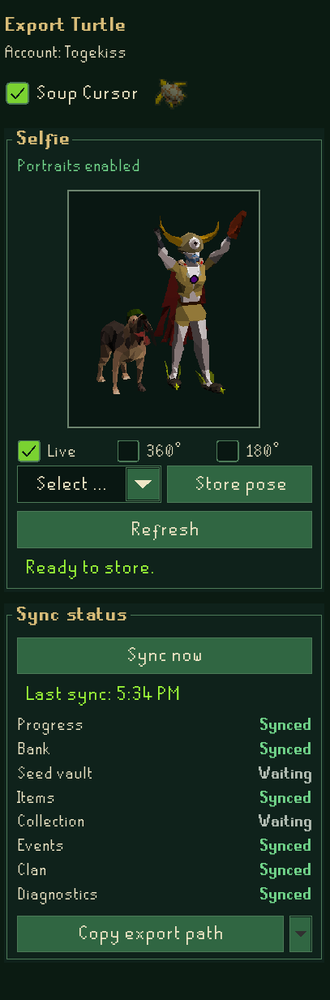
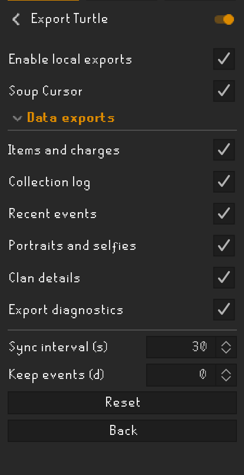

# Export Turtle

Export account data, character portraits and saved poses to local files.
No separate application or account is required. Nothing is uploaded.

| Export panel | Settings |
| --- | --- |
|  |  |

## Use

- **Selfie:** click **Refresh**, drag to rotate, scroll to zoom, then **Store pose**.
  Save up to three poses, with live animation, 180° sweeps or 360° rotation.
- **Soup Cursor:** enable the checkbox to use a custom Soup cursor.
- **Data:** open your bank and Collection Log, then click **Sync now**.
  Progress also exports automatically; each feature can be disabled in settings.
- **Files:** click **Copy export path**, or its arrow for a saved file's path.
  Paste the path into your file manager.

Includes skills, quests, diaries, combat achievements, collection logs, items,
observed charges, seed-vault contents, milestones, valuable drops and optional clan details.

Files stay in `.runelite/plugin-data/export-turtle/`. They contain private
account data and are not encrypted. Disabling exports keeps existing files; delete them manually if needed.

Charges retain confirmed checks alongside usage estimates for supported equipped weapons;
check again to reconcile. Bank, seed-vault and collection data need their interfaces opened. Temporary game modes do not export main-game progress.

[Export formats](docs/EXPORTS.md) · [Attribution](docs/ATTRIBUTION.md) · [License](LICENSE)

## Development

Java 11. Run `gradlew.bat test jar` on Windows or
`xvfb-run -a bash ./gradlew test jar` on Linux. Use `gradlew.bat run` for a development
client. This plugin is not currently available from Plugin Hub.
